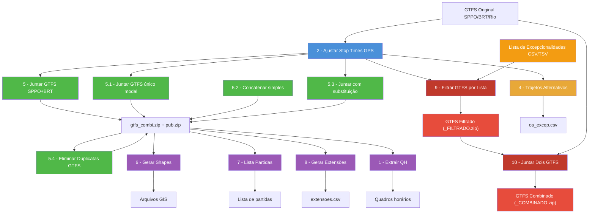

# Resumo dos Códigos Python — `codigos_py/`

Os scripts formam um **pipeline sequencial** de processamento de dados GTFS para o transporte público do Rio de Janeiro. Cada script lê a saída do anterior e produz insumos para o próximo.

---

## 🖥️ Interface Gráfica (Streamlit)

O projeto agora conta com uma aplicação web amigável desenvolvida em Streamlit para orquestrar a execução de todos os scripts do pipeline.

### Como Iniciar a Aplicação
1. Certifique-se de que as dependências estão instaladas (`pip install -r requirements.txt`).
2. Execute o comando abaixo na raiz do projeto:
```bash
python -m streamlit run src/app.py
```
3. Acesse pelo navegador em `http://localhost:8501`.

### Como Funciona
A interface possui uma barra lateral (Sidebar) para configuração de variáveis globais como `BASE_DADOS`, ano, mês e quinzena/estudo. O menu principal está dividido em abas, agrupando os scripts por finalidade (por exemplo, todos os scripts de "Juntar GTFS" na aba 5). O usuário pode fornecer parâmetros via interface (campos de texto ou upload de arquivos) e o script executará em segundo plano, com os logs (stdout) sendo exibidos em tempo real na tela.

### Execução via CLI (`--config`)
Todos os 10 scripts do repositório foram refatorados para aceitar um argumento dinâmico `--config` apontando para um JSON temporário gerado pela interface com todos os parâmetros a serem aplicados. Caso nenhum `--config` seja passado (como na execução clássica pelo terminal), os scripts mantêm **retrocompatibilidade** e usam as variáveis _hardcoded_ definidas no topo de cada arquivo Python.

---

## 1️⃣ `1_extrair_qh_especificado_no_gtfs.py`
**Objetivo:** Extrair o Quadro Horário (QH) de faixas de frequências de linhas específicas, a partir do GTFS combinado.

| Item | Descrição |
|------|-----------|
| **Entrada** | Arquivo GTFS ZIP combinado (`gtfs_combi_YYYY-MM-QQ.zip`) — tabelas `frequencies.txt` e `trips.txt` |
| **Filtros** | Lista de linhas (`linhas_rodar`) e calendários (`services_to_run`, ex: `U_REG`, `S_REG`, `D_REG`) |
| **Processamento** | Junta `frequencies` com `trips`, filtra por linha e serviço, identifica combinações únicas de (serviço, vista, calendário) |
| **Saída** | Um CSV por combinação em `resultados/quadro_horario_extraido/YYYY/MM/qh_por_linha/QQ/` com colunas: `trip_id`, `trip_headsign`, `trip_short_name`, `start_time`, `end_time`, `headway_secs` |
| **Dependências** | `pandas`, `zipfile`, `pathlib` |

---

## 1️⃣.1️⃣ `1.1_extrair_qh_partidas.py`
**Objetivo:** Extrair o Quadro Horário (QH) com a **grade detalhada de viagens individuais / partidas** de cada linha/sentido/dia a partir do GTFS.

| Item | Descrição |
|------|-----------|
| **Entrada** | Arquivo GTFS ZIP combinado (`gtfs_combi_YYYY-MM-QQ.zip`) — tabelas `trips.txt`, `frequencies.txt` e `stop_times.txt` |
| **Filtros** | Lista de linhas (`linhas_rodar`) e calendários (`services_to_run`, ex: `U_REG`, `S_REG`, `D_REG`) |
| **Processamento** | 1. Expande viagens programadas por faixas de frequência (`frequencies.txt`) pelo `headway_secs`.<br>2. Para viagens regulares (sem frequência), extrai o horário de partida no primeiro ponto em `stop_times.txt`.<br>3. Ordena cronologicamente por sentido/linha/dia e calcula `ordem_partida` e `intervalo_min`. |
| **Saída** | Arquivos CSV sanitizados por combinação em `resultados/quadro_horario_extraido/YYYY/MM/qh_partidas_por_linha/QQ/` com colunas: `ordem_partida`, `trip_short_name`, `trip_headsign`, `service_id`, `direction_id`, `departure_time`, `intervalo_min`, `trip_id` |
| **Dependências** | `pandas`, `zipfile`, `re`, `pathlib`, `json`, `argparse` |

---

## 1️⃣.2️⃣ `1.2_combinar_quadros_horarios.py`
**Objetivo:** Combinar quadros de horários de diferentes serviços/calendários com recorte por faixa horária (ex.: gerar quadros de domingo `D_REG` aproveitando as faixas de dia útil `U_REG` entre 06h e 20h).

| Item | Descrição |
|------|-----------|
| **Entrada** | Arquivos CSV de faixas gerados pelo script `1` (`qh_por_linha`) |
| **Parâmetros** | `servico_origem` (ex: `U_REG`), `servico_destino` (ex: `D_REG`), `hora_inicio` (ex: `06:00:00`), `hora_fim` (ex: `20:00:00`), `linhas_rodar` |
| **Processamento** | 1. Mantém faixas originais do serviço de destino antes de `hora_inicio` e após `hora_fim`, ajustando bordas que cruzam os limites.<br>2. Importa faixas do serviço de origem na janela `[hora_inicio, hora_fim)`, clipando nas bordas.<br>3. Se a linha não tiver destino original, cria o quadro contendo a faixa importada.<br>4. Ordena cronologicamente por `start_time`. |
| **Saída** | Arquivos CSV no formato do Script 1 em `resultados/quadro_horario_extraido/YYYY/MM/qh_por_linha_combinado/QQ/` com colunas: `trip_id`, `trip_headsign`, `trip_short_name`, `start_time`, `end_time`, `headway_secs` |
| **Dependências** | `pandas`, `pathlib`, `re`, `json`, `argparse` |

---

## 1️⃣.3️⃣ `1.3_qh_a_partir_de_partidas.py`
**Objetivo:** Gerar quadros de horário **factíveis** no formato do Script 1 a partir de uma tabela agregada de contagens de partidas por linha/sentido/faixa (ex.: montada a partir do arquivo de partidas do Script 7), sem depender do GTFS.

| Item | Descrição |
|------|-----------|
| **Entrada** | Tabela CSV de contagens (`caminho_partidas`), em **um dos dois formatos**: (a) **wide** — uma linha por (Serviço, Vista, Consórcio, Sentido) e uma coluna por faixa (`00:00-01:00` … `23:00-24:00`), formato default; (b) **longo** — uma linha por (Serviço, Sentido, Faixa) com as colunas `Faixa` e `Partidas_Faixa`. No formato wide as colunas de faixa são derretidas (melt) automaticamente. Colunas tolerantes a acento/caixa; `-` ou vazio em contagens tratados como 0 (`traco_ausente`: `zerar`\|`erro`). |
| **Parâmetros** | `caminho_partidas` (default `partidas_pf_sppo_como_du.csv`), `service_id` (default `F_REG`), `granularidade_headway` (default 300s), `traco_ausente`, `linhas_rodar`, `gerar_excel` (default True), `nome_excel`, `tipo_dia`, `pasta_saida` |
| **Processamento** | 1. Deriva o `trip_headsign` da vista (`Origem - Destino`): Ida → destino, Volta → origem, Circular → literal `Circular`.<br>2. Por cada faixa com n>0, gera 1 banda: `h = (dur//n // 300)*300` (se `h==0`, usa o bruto `dur//n` — a contagem é sempre preservada, o que cede é a granularidade); `start = início da faixa`; `end = start + n*h` (sem vazamento).<br>3. Gate duro antes de gravar: reexpansão = entrada, nenhuma banda fora da faixa, headway múltiplo da granularidade, total in = total out. |
| **Saída** | (1) Um CSV por quadro no formato idêntico ao Script 1 (`trip_id` vazio) em `resultados/quadro_horario_extraido/YYYY/MM/qh_por_linha_partidas/QQ/` com colunas: `trip_id`, `trip_headsign`, `trip_short_name`, `start_time`, `end_time`, `headway_secs`; (2) um Excel `quadros_partidas_{service_id}.xlsx` com **uma aba por linha** (servico) e **um bloco por quadro** (cabeçalho `Linha`/`Trip headsign`/`Tipo dia` + tabela `Partida`\|`Horário`\|`Intervalo`, partidas expandidas em HH:MM:SS); (3) relatórios `relatorio_bandas.csv` e `_resumo.txt`. |
| **Dependências** | `pandas`, `openpyxl`, `pathlib`, `re`, `json`, `argparse` |

> [!NOTE]
> Sem aba Streamlit ainda — executar via CLI: `python codigos_py/1.3_qh_a_partir_de_partidas.py [--config config.json]`.

---

## 1️⃣.3️⃣.1️⃣ `1.3.1_conferir_partidas_geradas.py`
**Objetivo:** Conferir de forma **independente** que os quadros gerados pelo Script 1.3 têm o mesmo número de partidas da tabela de entrada (rele a entrada e os `horarios_*.csv` do disco; não confia no `_resumo.txt` nem no `relatorio_bandas.csv` da geração).

| Item | Descrição |
|------|-----------|
| **Entrada** | Tabela de contagens usada na geração (wide ou longo) + pasta de saída do 1.3 contendo os `horarios_*.csv` (e, opcionalmente, o Excel) |
| **Parâmetros** | `caminho_partidas`, `pasta_saida`, `service_id` (default `F_REG`), `linhas_rodar` (deve refletir o filtro da geração), `traco_ausente`, `verificar_excel` (default True), `nome_excel` |
| **Processamento** | 1. Rele a entrada (wide/melt ou longo) e deriva o headsign esperado por (servico, sentido).<br>2. Para cada grupo: valida existência do CSV (`FALTANDO`/`SOBRANDO`/`ÓRFÃO`), reexpande cada banda (`n=(end−start)/headway`) validando `headway≥1`, divisibilidade, `start` na faixa e `end≤fim da faixa` (`BANDA`).<br>3. Soma por (servico, sentido, faixa) e compara com a entrada (`OK`/`DIVERGENTE` com Δ).<br>4. Se `verificar_excel`: conta partidas por bloco do `.xlsx` e bate com a expansão dos CSVs (`EXCEL`). |
| **Saída** | `relatorio_conferencia_partidas.csv` (uma linha por célula + anomalias) e `_conferencia_resumo.txt` na pasta conferida; exit code 0 = tudo OK, 1 = anomalia |
| **Dependências** | `pandas`, `openpyxl`, `pathlib`, `re`, `json`, `argparse` |

> [!NOTE]
> Sem aba Streamlit ainda — executar via CLI: `python codigos_py/1.3.1_conferir_partidas_geradas.py --config config.json`.

---

## 1️⃣.4️⃣ `1.4_qh_pf_a_partir_do_gtfs.py`
**Objetivo:** Gerar quadros de **ponto facultativo** (`F_REG`) no formato do Script 1 direto das frequências (`frequencies.txt`) de um GTFS, para toda a rede de ônibus convencional exceto MOBI-Rio: base **DU** (`U_REG`) nos consórcios Internorte/Intersul/Transcarioca/Santa Cruz e base **sábado** (`S_REG`) em GTU/TUSE.

| Item | Descrição |
|------|-----------|
| **Entrada** | GTFS ZIP (default `0171_gtfs_out_26_1E_ret.zip` na raiz do repositório; `end_gtfs` na config) — lê `frequencies.txt`, `trips.txt`, `routes.txt`, `agency.txt` |
| **Parâmetros** | `end_gtfs`, `service_id` (default `F_REG`), `mapa_base` (agency_id → service de origem: `22003/22002/22004/22005`→`U_REG`, `A2/B2`→`S_REG`), `agencias_excluidas` (default `["20001"]` MOBI-Rio inteira), `route_types_permitidos` (default `["700"]`), `linhas_rodar`, `pasta_saida`, `gerar_excel`, `nome_excel`, `tipo_dia` |
| **Processamento** | 1. Merge `frequencies→trips→routes→agency` e filtros: agências-base, sem MOBI-Rio, `route_type=700` (exclui BRT 702 e Metrô 200), service_id igual ao do `mapa_base`.<br>2. Agrupa bandas por `(trip_short_name, trip_headsign)` — 1 CSV por grupo, service de saída `F_REG`.<br>3. Gate antes de gravar: bandas preservadas entrada×saída por (linha, headsign, start, end, headway), `headway≥1`, `end>start`, `n=ceil((end−start)/headway)≥1`, total de partidas in = out. |
| **Saída** | Pasta própria `resultados/quadro_horario_extraido/YYYY/MM/qh_por_linha_pf_gtfs/QQ/`: (1) CSVs `horarios_{linha}_{headsign}_F_REG.csv` no formato do Script 1 (`trip_id` vazio); (2) Excel `quadros_partidas_F_REG.xlsx` (uma aba por linha, bloco por quadro com `Partida`\|`Horário`\|`Intervalo`); (3) `relatorio_bandas.csv` (com `service_id_origem` p/ auditoria) e `_resumo.txt` |
| **Dependências** | `pandas`, `openpyxl`, `pathlib`, `zipfile`, `re`, `json`, `math`, `argparse` |

> [!NOTE]
> Sem aba Streamlit — executar via CLI: `python codigos_py/1.4_qh_pf_a_partir_do_gtfs.py [--config config.json]`.

---

## 2️⃣ `2_ajustar_stop_times.py`
**Objetivo:** Recalcular os horários de parada (`stop_times`) do GTFS usando **velocidades reais extraídas de dados GPS** de viagens realizadas.

| Item | Descrição |
|------|-----------|
| **Entrada** | GTFS original (SPPO ou BRT) + dados de viagens reais (Parquet/CSV) + calendário de feriados (`calendario.json`) |
| **Etapas** | 1. Carrega viagens GPS (BRT=CSV, SPPO=Parquet + Frescão) |
|  | 2. Calcula sumários de velocidade média por (serviço, direção, hora, tipo de dia) com remoção de outliers via IQR |
|  | 3. Lê GTFS, ajusta `shape_dist_traveled` para começar em 0, corrige horários faltantes usando distância + velocidade padrão |
|  | 4. Recalcula `arrival_time`/`departure_time` usando velocidades GPS reais, garantindo monotonicidade |
|  | 5. Valida integridade (nenhum horário vazio/nulo) |
| **Saída** | Novo ZIP GTFS com sufixo `_PROC.zip` (apenas `stop_times.txt` e `routes.txt` são substituídos) |
| **Dependências** | `pandas`, `numpy`, `zipfile`, `json` |

> [!IMPORTANT]
> Este é o script mais complexo do pipeline (~584 linhas). Ele é o coração do ajuste de qualidade do GTFS.

---

~~## 3️⃣ `3_desvios_nao-utilizar.py`~~

> Este código está datado e **não tem mais utilidade**. Usar `4_trajetos_alternativos.py` para trabalhar com excepcionalidades.

---

## 4️⃣ `4_trajetos_alternativos.py`
**Objetivo:** Gerar um **relatório CSV** dos trajetos alternativos (desvios), listando serviços, vistas, consórcios, sentidos e extensões em km.

| Item | Descrição |
|------|-----------|
| **Entrada** | GTFS processado (`_PROC.zip`) — tabelas `trips`, `routes`, `agency`, `shapes` |
| **Processamento** | 1. Identifica viagens de desvio (trip_headsign contendo `[...]`) |
|  | 2. Remove frescões (`route_type == 200`) |
|  | 3. Calcula extensão geográfica dos shapes via GIS (projeção EPSG:31983) |
|  | 4. Agrupa por (serviço, vista, consórcio, sentido, evento) |
| **Saída** | CSV em `dados/os/os_YYYY-MM-QQ_excep.csv` com colunas: Serviço, Vista, Consórcio, Sentido, Extensão, Evento |
| **Dependências** | `pandas`, `geopandas`, `shapely` |

---

## 5️⃣ `5_juntar_gtfs.py`
**Objetivo:** **Combinar** os GTFS processados do SPPO e do BRT em um único GTFS unificado, aplicar limpezas, cores e gerar versão pública.

| Item | Descrição |
|------|-----------|
| **Entrada** | `sppo_YYYY-MM-QQ_PROC.zip` + `brt_YYYY-MM-QQ_PROC.zip` + insumos (cores, trip_id_fantasma, arquivos de substituição) |
| **Etapas** | 1. Carrega e processa SPPO: define `route_type` (700/200), ajusta `service_id`, remove trips fantasma e sem stop_times |
|  | 2. Carrega e processa BRT: preserva `route_type` original, ajusta `service_id` |
|  | 3. Concatena todos os arquivos GTFS (trips, routes, stops, shapes, etc.) |
|  | 4. Limpeza: remove paradas "APAGAR", colunas desnecessárias, ordena shapes, valida horários |
|  | 5. Salva GTFS combinado e substitui arquivos (calendar_dates, fare_attributes, fare_rules, feed_info) com insumos externos |
|  | 6. Gera versão pública: remove trips EXCEP, aplica cores personalizadas (`gtfs_cores.csv`), salva `gtfs_rio-de-janeiro_pub.zip` |
| **Saída** | `gtfs_combi_YYYY-MM-QQ.zip` (interno) + `gtfs_rio-de-janeiro_pub.zip` (público) |
| **Dependências** | `pandas`, `numpy`, `zipfile` |

> [!TIP]
> A função `clean_gtfs()` implementa uma limpeza em cascata equivalente ao `gtfstools::filter_by_trip_id` do R — remove registros órfãos de todas as tabelas associadas.

---

## 5️⃣.1️⃣ `5.1_juntar_gtfs_sppo.py`
**Objetivo:** Variante do script 5 para processar **um único GTFS** (SPPO, BRT ou Rio), sem combinar com outro modal. Gera o GTFS combinado e público a partir de uma única fonte.

| Item | Descrição |
|------|-----------|
| **Entrada** | Um único GTFS processado (`_PROC.zip`) do tipo `sppo`, `brt` ou `rio` + insumos de substituição |
| **Diferencial** | Suporta múltiplas **etapas** do GTFS Rio (ex: `"ETAPA_01,ETAPA_02"`), agregando `calendar_dates` e demais arquivos de substituição de múltiplas pastas |
| **Etapas** | Idênticas ao script 5, mas para uma única fonte (sem etapa de combinação SPPO+BRT) |
| **Pastas de substituição** | Resolução hierárquica: busca pastas específicas por etapa, com fallback para a pasta base |
| **Saída** | `gtfs_combi_YYYY-MM-QQ.zip` (interno) + `gtfs_rio-de-janeiro_pub.zip` (público) |
| **Dependências** | `pandas`, `numpy`, `zipfile` |

> [!NOTE]
> Use este script quando apenas **um modal** (ex: somente Rio) precisa ser publicado, sem combinar SPPO+BRT.

---

## 5️⃣.2️⃣ `5.2_juntar_gtfs_simples.py`
**Objetivo:** Concatenação simples de **N arquivos GTFS ZIP** em um único arquivo, sem limpezas avançadas ou lógica de negócio. Útil para testes e inspeções rápidas.

| Item | Descrição |
|------|-----------|
| **Entrada** | Lista de arquivos GTFS ZIP (`INPUT_ZIPS`) configurada diretamente no script |
| **Processamento** | 1. Lê todos os ZIPs e concatena cada tabela `.txt` |
|  | 2. Remove linhas exatamente duplicadas de cada tabela |
| **Saída** | Um único ZIP em `OUTPUT_ZIP` configurado no script |
| **Dependências** | `pandas`, `zipfile` |

---

## 5️⃣.3️⃣ `5.3_juntar_gtfs_substituicao.py`
**Objetivo:** Juntar dois arquivos GTFS garantindo que as linhas (`route_short_name`) do segundo GTFS substituam integralmente as linhas correspondentes no primeiro GTFS.

| Item | Descrição |
|------|-----------|
| **Entrada** | Dois arquivos GTFS ZIP (`GTFS_1_PATH` e `GTFS_2_PATH`) |
| **Processamento** | 1. Carrega ambos os GTFSs. <br>2. Identifica rotas redundantes no GTFS 1 com base no `route_short_name` do GTFS 2. <br>3. Remove essas rotas do GTFS 1 e aplica a limpeza em cascata (`clean_gtfs`) para remover registros órfãos. <br>4. Concatena os registros restantes do GTFS 1 com o GTFS 2. <br>5. Elimina duplicatas exatas. |
| **Saída** | GTFS unificado salvo em `OUTPUT_ZIP` |
| **Dependências** | `pandas`, `numpy`, `zipfile`, `pathlib` |

---

## 5️⃣.4️⃣ `5.4_eliminar_duplicatas_gtfs.py`
**Objetivo:** **Eliminar duplicatas em linhas regulares** em arquivos GTFS (`gtfs_combi`, `gtfs_pub` ou qualquer GTFS indicado), **preservando 100% das viagens de excepcionalidades (`EXCEP` e desvios)**.

| Item | Descrição |
|------|-----------|
| **Entrada** | Caminho do arquivo GTFS ZIP no PC (`endereco_gtfs`, ex: `C:/R_SMTR/dados/GTFS/2027/gtfs_combi_2026-07-02Q.zip`) |
| **Critério de preservação** | Viagens com `service_id` contendo `EXCEP` ou com `[...]` no `trip_headsign` são mantidas 100% intactas sem qualquer exclusão |
| **Processamento** | 1. Separa viagens regulares de viagens `EXCEP`. <br>2. Identifica rotas regulares duplicadas por `route_short_name` e unifica `route_id` mantendo a primeira ocorrência. <br>3. Remove trips regulares redundantes por assinatura `(serviço, direction_id, service_id, horários/frequência de partida)`. <br>4. Aplica `clean_gtfs` em cascata para remover registros órfãos nas demais tabelas (`stop_times`, `shapes`, `stops`, `calendar`, etc.). |
| **Saída** | Arquivo GTFS atualizado sem duplicatas (sobrescreve o original ou salva no caminho definido em `caminho_saida`) |
| **Dependências** | `pandas`, `numpy`, `zipfile`, `pathlib` |

---

## 6️⃣ `6_gerar_shapes.py`
**Objetivo:** Gerar **arquivos geoespaciais** (Shapefile + GeoPackage) dos trajetos (linhas) e pontos de parada a partir do GTFS público.

| Item | Descrição |
|------|-----------|
| **Entrada** | GTFS público (`gtfs_rio-de-janeiro_pub.zip`) + `descricao_desvios.csv` (opcional) |
| **Processamento** | 1. Ordena shapes e remove inválidos (< 2 pontos) |
|  | 2. Prioriza shapes por tipo de serviço: U_REG → *_REG → especial U → outros |
|  | 3. Converte coordenadas em `LineString`, projeta para EPSG:31983, calcula extensão |
|  | 4. Enriquece com metadados: consórcio, tipo de rota (regular/BRT/frescão), tarifas, descrição de desvios |
|  | 5. Exporta trajetos (linhas) e pontos de parada |
| **Saída** | Em `dados/shapes/YYYY/`: |
|  | - `shapes_trajetos_YYYY-MM-QQ.shp` + `.gpkg` (trajetos como LineStrings) |
|  | - `shapes_pontos_YYYY-MM-QQ.shp` + `.gpkg` (paradas como Points, com `route_type` agregado) |
| **Dependências** | `pandas`, `numpy`, `geopandas`, `shapely`, `pyogrio` |

---

## 7️⃣ `7_lista_partidas.py`
**Objetivo:** Gerar a **lista completa de partidas** (horários de saída) por tipo de dia, consolidando viagens por frequência e por quadro horário regular.

| Item | Descrição |
|------|-----------|
| **Entrada** | GTFS combinado (default do CLI: `gtfs/2030/0175_gtfs_out_26_1E_ret3.zip`; aba Streamlit: `gtfs_combi_2026-10-02Q_RIO.zip`) |
| **Processamento** | 1. Filtra frescões e trips fantasma |
|  | 2. Calcula extensões dos shapes via GIS (EPSG:31983) — **máximo por itinerário, excluindo trips `EXCEP` e desvios** (`[` no `trip_headsign`), mesma regra dos scripts 8/8.1 (o 7 não filtra `route_type`, para cobrir o BRT 702) |
|  | 3. Para cada tipo de dia (DU/SAB/DOM/PF — `pf` = ponto facultativo, `service_id` `F_REG`): |
|  |    a. Expande `frequencies.txt` em partidas individuais (start → end, incrementando headway) |
|  |    b. Extrai horários do primeiro ponto (`stop_sequence=0`) para linhas sem frequência |
|  |    c. Enriquece com nome da rota, agência, extensão, faixa horária |
|  |    d. Calcula intervalos entre partidas consecutivas |
| **Saída** | Em `resultados/partidas/`: |
|  | - `partidas_du.csv`, `partidas_sab.csv`, `partidas_dom.csv`, `partidas_pf.csv` (individuais com intervalo) |
|  | - `partidas_YYYY-MM-QQ.csv` + `.parquet` (consolidado de todos os dias, coluna `tipo_dia`) |
| **Dependências** | `pandas`, `numpy`, `geopandas`, `shapely`, `pyarrow` |

---

## 7️⃣.1️⃣ `7.1_resumo_os_domingo_du.py`

> Este código contém erros e **deve ser evitado**. Mantido apenas para referência.

**Objetivo:** Gerar tabela resumo de partidas por faixa horária para **Domingo** no formato da tabela de OS, combinando partidas de diferentes tipos de dia: importa as partidas de **Dia Útil** entre 06h e 20h e mantém as partidas de **Domingo** fora desse intervalo, para compor um único quadro de domingo ajustado.

| Item | Descrição |
|------|-----------|
| **Entrada** | Arquivo `partidas_YYYY-MM-QQ.parquet` (ou `.csv`) gerado pelo Script 7 |
| **Processamento** | 1. Faz combinação de partidas de diferentes tipos de dia: seleciona `tipo_dia == 'du'` entre 06:00:00 e 20:00:00 e `tipo_dia == 'dom'` antes de 06:00:00 e a partir de 20:00:00 para formar o quadro de Domingo ajustado.<br>2. Agrupa por (Serviço, Vista, Consórcio, Sentido, Extensão).<br>3. Pivota contagem de partidas pelas 14 faixas horárias padrão.<br>4. Intercala colunas de Partidas e Quilometragem (em branco), no formato da tabela de OS. |
| **Saída** | `tabela_domingo_ajustada.xlsx` e `tabela_domingo_ajustada.csv` (formato OS com 33 colunas) |
| **Dependências** | `pandas`, `openpyxl`, `pyarrow`, `pathlib`, `json`, `argparse` |

---

## 7️⃣.2️⃣ `7.2_combinador_partidas.py`
**Objetivo:** Combinar partidas de diferentes tipos de dia no formato do arquivo de partidas gerado pelo Script 7. Gera um arquivo de partidas consolidado para Domingo, substituindo o bloco diurno (06:00:00–20:00:00, exclusivo) pelas partidas de Dia Útil, mantendo a madrugada e a noite do próprio Domingo.

| Item | Descrição |
|------|-----------|
| **Entrada** | Arquivos CSV de partidas (`partidas_du.csv`, `partidas_dom.csv`) gerados pelo Script 7 |
| **Processamento** | 1. Lê os arquivos de partidas de Dia Útil e Domingo.<br>2. Mantém apenas os serviços presentes em `partidas_dom.csv`.<br>3. Divide as partidas de Domingo em madrugada (< 06:00:00) e noite (>= 20:00:00).<br>4. Seleciona as partidas de Dia Útil na janela 06:00:00–20:00:00 (exclusivo).<br>5. Compatibiliza o campo `intervalo` nas transições (05:59→06:00 e 19:59→20:00) para manter consistência entre partidas consecutivas.<br>6. Concatena os blocos (Domingo madrugada + Dia Útil diurno + Domingo noite), ordenados por `departure_time` dentro de cada serviço/sentido. |
| **Saída** | Arquivo CSV de partidas no formato do Script 7 (padrão: `quadros_dom_04-10.csv`) |
| **Dependências** | `pandas` |

---

## 8️⃣ `8_gerar_extensoes.py`
**Objetivo:** Gerar uma listagem consolidada de linhas por sentido e vista, com o cálculo da maior extensão (em metros) para cada serviço.

| Item | Descrição |
|------|-----------|
| **Entrada** | GTFS público (`gtfs_rio-de-janeiro_pub.zip`) |
| **Processamento** | 1. Filtra rotas SPPO (route_type=3 ou 700). |
|  | 2. Remove viagens de exceção/desvio (`service_id == EXCEP` ou `[` no `trip_headsign`). |
|  | 3. Calcula extensões geográficas de todos os shapes (EPSG:31983). |
|  | 4. Consolida a maior extensão por (Serviço, Vista, Sentido). |
| **Saída** | CSV em `resultados/extensoes/extensoes_YYYY-MM-QQQ.csv` |
| **Dependências** | `pandas`, `geopandas`, `shapely` |

---

## 8️⃣.1️⃣ `8.1_gerar_extensoes_rio.py`
**Objetivo:** Variante do script 8 para processar arquivos GTFS no formato simplificado `rio_YYYY-MM.zip`.

| Item | Descrição |
|------|-----------|
| **Entrada** | GTFS em `dados/gtfs/YYYY/rio_YYYY-MM.zip` |
| **Processamento** | Idêntico ao script 8 (filtra `route_type` 3/700, remove EXCEP/desvio, extensões via GIS EPSG:31983), adaptado para o novo padrão de nomenclatura de arquivos `rio_YYYY-MM.zip`. |
| **Saída** | CSV em `resultados/extensoes/extensoes_rio_YYYY-MM.csv` |

---

## 9️⃣ `9_filtrar_gtfs_por_lista.py`
**Objetivo:** Gerar um **GTFS filtrado** contendo apenas as trips presentes em uma lista de excepcionalidades/desvios, combinando cinco critérios de correspondência.

| Item | Descrição |
|------|-----------|
| **Entrada** | GTFS processado (`_PROC.zip`) + lista embutida no script (TSV com colunas Serviço, Vista, Consórcio, Sentido, Extensão, Evento) |
| **Critério de filtro** | Junção por chave composta: `trip_short_name` + `route_long_name` + `agency_name` + `direction_id` + evento extraído do `trip_headsign` (`[...]`) |
| **Processamento** | 1. Filtra trips pelo calendário alvo (padrão: `EXCEP`) |
|  | 2. Enriquece trips com `route_long_name` e `agency_name` via join |
|  | 3. Extrai o evento do `trip_headsign` e compõe a chave de junção |
|  | 4. Aplica `clean_gtfs` em cascata para remover stop_times, shapes, stops e calendar_dates órfãos |
|  | 5. Reporta entradas da lista sem match no GTFS |
| **Saída** | `sppo_YYYY-MM-QQ_FILTRADO.zip` |
| **Dependências** | `pandas`, `numpy`, `zipfile` |

> [!TIP]
> A coluna **Extensão** da lista de filtro é apenas referência — não entra na chave de correspondência. O script reporta explicitamente quais entradas da lista **não tiveram match** no GTFS.

---

## 1️⃣0️⃣ `10_juntar_dois_gtfs.py`
**Objetivo:** **Juntar dois arquivos GTFS** em um único, eliminando duplicatas com controle de precedência por chave primária GTFS.

| Item | Descrição |
|------|-----------|
| **Entrada** | `GTFS_PRINCIPAL` (tem precedência) + `GTFS_SECUNDARIO` — tipicamente o GTFS filtrado + o GTFS completo |
| **Estratégia de deduplicação** | Para cada tabela `.txt`: |
|  | 1. Remove linhas 100% idênticas (`drop_duplicates` na linha inteira) |
|  | 2. Remove conflitos de chave primária, mantendo o registro do PRINCIPAL (`keep='first'`) |
| **Chaves primárias** | Definidas em `CHAVES_PRIMARIAS` por tabela: `trip_id` para trips, `[trip_id, stop_sequence]` para stop_times, `[shape_id, shape_pt_sequence]` para shapes, etc. |
| **Pós-processamento** | Aplica `clean_gtfs` para remover registros órfãos resultantes da fusão |
| **Saída** | `sppo_YYYY-MM-QQ_COMBINADO.zip` |
| **Dependências** | `pandas`, `numpy`, `zipfile` |

> [!IMPORTANT]
> O GTFS definido em `GTFS_PRINCIPAL` **sempre vence** em caso de conflito de chave primária. Use o GTFS filtrado (saída do script 9) como principal para garantir que os trajetos alternativos corretos prevaleçam.

---

## 📊 Visão Geral do Pipeline



> [!NOTE]
> A validação do GTFS de entrada (script **0**) foi movida para o projeto externo `C:\github_repositories\validacao`, junto com o validador pós-pipeline `validar_gtfs.py`. O script **2** é a entrada principal para todos os modais. Os scripts **5**, **5.1**, **5.2** e **5.3** são alternativas de combinação; o script **5.4** elimina duplicatas em linhas regulares (preservando EXCEP) nos GTFS combinados/públicos. Os scripts **4**, **6**, **7**, **7.1**, **7.2**, **8** e **8.1** são etapas de pós-processamento/exportação independentes: **7.1** e **7.2** combinam partidas de diferentes tipos de dia (Dia Útil × Domingo), respectivamente no formato da tabela de OS e no formato do arquivo de partidas gerado pelo script 7. Os scripts **9** e **10** formam um sub-fluxo independente para geração de GTFSs com excepcionalidades/desvios selecionados.
